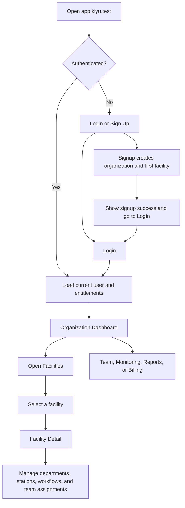

# KIYU Frontend PRD — Part 2
## Role-Based User Journeys, Navigation, and Facility Management

**Document type:** Product Requirements Document  
**Product:** KIYU — Queue Management SaaS  
**Audience:** Claude Code implementation agent, frontend engineers, product/design reviewers  
**Companion document:** KIYU Frontend PRD — Part 1  
**Language:** English

---

## 1. Purpose and Scope

Part 2 defines how each KIYU user enters the application, reaches the correct workspace, navigates its menus, and completes role-specific tasks. It also defines the facility-management information architecture, including the facility-selection flow and the detail pages used to manage departments, stations, workflows, and staff assignments.

This document supplements Part 1. It does not replace the architecture, visual-system, shadcn/ui, loading-state, coding-quality, or general backend-integration requirements already defined there. When both documents apply, follow the stricter requirement.

### 1.1 Primary objectives

1. Give every role a clear and purpose-built application journey.
2. Separate organization-level administration from facility-level operations.
3. Make facility selection explicit and persistent when a user can access multiple facilities.
4. Organize facility configuration under a selected facility instead of exposing unrelated global configuration menus.
5. Keep navigation consistent with actual role permissions and backend capabilities.
6. Avoid inventing pages, settings, or workflows that are not supported by the current backend contract.

### 1.2 Out of scope

- Changing the Laravel API or database schema.
- Adding backend capabilities that do not currently exist.
- Defining a new authorization model. The backend remains the authorization authority.
- Building a separate frontend project for every subdomain. The frontend remains one codebase with separate application shells and context-specific modules.
- Introducing unsupported business concepts such as appointment calendars, payment collection from customers, working-hour schedules, holidays, or configurable service-level policies unless the backend contract is extended.

---

## 2. Application Domains and Entry Points

The frontend must recognize these distinct application contexts.

| Domain | Application | Authentication | Primary audience |
|---|---|---|---|
| `kiyu.test` | Public Website | No authentication pages | Visitors and prospective customers |
| `app.kiyu.test` | App Console | Login and Sign Up | `tenant_admin` |
| `{tenant}.kiyu.test` | Tenant Workspace and Customer Portal | Login with Staff/Admin and Customer modes; Customer registration where enabled | `facility_admin`, `operator`, `staff`, `customer` |
| `portal.kiyu.test` | Platform Portal | Login only | `platform_admin` |
| `api.kiyu.test` | Central API | Not a user-facing application | Frontend API requests |

`{tenant}.kiyu.test` is a wildcard tenant hostname. For example, `clinic-a.kiyu.test` is one tenant's hostname. Do not implement a single shared hostname literally named `tenant.kiyu.test` for all tenants.

### 2.1 Domain-level entry behavior

- `kiyu.test`: show the public marketing website. Do not show a login or registration page on this domain. The primary CTA should lead to `app.kiyu.test/signup`; the login link should lead to `app.kiyu.test/login`.
- `app.kiyu.test`: provide `/login` and `/signup` for organization owners (`tenant_admin`).
- `{tenant}.kiyu.test`: provide a shared authentication entry page with two explicit modes: **Staff / Admin** and **Customer**. Staff/Admin mode has login only. Customer mode has login and conditional sign up.
- `portal.kiyu.test`: provide `/login` only. There is no public platform-admin registration.
- Kiosk and Display are device applications under the tenant hostname. They do not use normal user login.

### 2.2 Authentication context isolation

The following API contexts and tokens are separate and must never be interchanged:

| Context | API prefix | Allowed role(s) | Token ability | Origin |
|---|---|---|---|---|
| Public | `/api/public` | None | None | `kiyu.test` |
| App | `/api/app` | `tenant_admin` | `ctx:app` | `app.kiyu.test` |
| Tenant | `/api/tenant` | `facility_admin`, `operator`, `staff` | `ctx:tenant` | `{tenant}.kiyu.test` |
| Customer | `/api/customer` | `customer` | `ctx:customer` | `{tenant}.kiyu.test` |
| Portal | `/api/portal` | `platform_admin` | `ctx:portal` | `portal.kiyu.test` |

The browser `Origin` selects the backend context; it does not authenticate or authorize the user. The backend still validates token context, role, tenant membership, facility assignment, permissions, and entitlements.

**Critical rule:** Do not use an App token to call Tenant endpoints, a Tenant token to call Customer endpoints, or any other cross-context token combination. Even though Customer and Tenant share a hostname, their API clients, sessions, tokens, and authorization contexts remain separate.

---

## 3. Core Navigation and Facility Context Rules

### 3.1 Organization versus facility scope

KIYU has two different administrative scopes:

- **Organization scope:** organization-wide information and administration managed by `tenant_admin` on `app.kiyu.test`.
- **Facility scope:** operational configuration and day-to-day activity for a specific facility, managed by facility-level roles on `{tenant}.kiyu.test`.

Do not merge these into one generic dashboard or one role-conditional sidebar. They are different workspaces with different API contexts and responsibilities.

### 3.2 Facility selection behavior

Facility selection must be based on the authenticated user's accessible facilities.

1. After authentication, fetch the current user through the correct context's `/auth/me` endpoint.
2. Read the user's `facilities` and `facility_ids` from the authenticated user payload.
3. If the user has exactly one active facility, select it automatically. Do not force the user through an unnecessary selection page.
4. If the user has multiple active facilities, show a facility-selection screen or require selection through the global facility switcher before displaying facility-scoped data.
5. If the user has no accessible active facility, show a clear empty/access state. Do not silently select an unrelated facility.
6. A facility switch must refresh all facility-scoped queries and invalidate stale data from the previous facility.
7. The selected facility must remain identifiable after refresh and deep-link navigation. Prefer a route parameter or another deterministic URL-backed state; do not rely only on transient component state.

`tenant_admin` can access organization facilities from the App Console. `facility_admin` and `operator` can access only their assigned facilities in the Tenant Workspace. Staff should normally land directly in their assigned service workstation; only show facility selection when the backend user payload genuinely provides multiple accessible facilities.

### 3.3 Facility ID transport

The current backend contract does not define a facility header or facility middleware. Follow these rules:

- GET requests: pass `facility_id` in the query string when required.
- Mutations: pass `facility_id` in the JSON request body when required.
- If the user has exactly one active accessible facility, the backend can automatically use it. The frontend should still maintain a coherent selected-facility context for its UI.
- Never invent `X-Facility-ID` or another facility header.
- Never trust a client-side facility ID as authorization. The backend must validate access.

### 3.4 Facility selection UI

When multiple facilities are available, the selector should show enough context to distinguish them:

- Facility name.
- Facility code, when available.
- Address or location, when available.
- Active/inactive state, when available.

For the App Console, the Facilities page is the primary facility-selection surface. Within a facility detail page, show the selected facility name and provide a clear way to return to the Facilities list or switch facilities.

For the Tenant Workspace, place a compact facility switcher in the application header only when the user can access more than one facility. Do not render a redundant switcher for single-facility users.

---

## 4. Role-Based Journeys and Navigation

There are six human user roles. Kiosk and Display are device modes, not user roles.

### 4.1 Role summary

| Role | Domain | Main job | Experience type |
|---|---|---|---|
| `platform_admin` | `portal.kiyu.test` | Operate the KIYU SaaS platform | Platform management |
| `tenant_admin` | `app.kiyu.test` | Manage an organization, its facilities, team, subscription, and organization-wide performance | Organization management |
| `facility_admin` | `{tenant}.kiyu.test` | Configure and supervise one or more assigned facilities | Facility management and operations |
| `operator` | `{tenant}.kiyu.test` | Register arrivals, manage reception, and support queue operations | Reception workstation |
| `staff` | `{tenant}.kiyu.test` | Serve the next customer at an assigned station | Focused service workstation |
| `customer` | `{tenant}.kiyu.test` | Book or track their own visit and manage their profile | Mobile-first self-service |

### 4.2 Platform Admin — `platform_admin`

**Entry flow**

1. Open `portal.kiyu.test`.
2. If unauthenticated, show the Platform Portal login page.
3. Submit credentials to `/api/portal/auth/login`.
4. Load `/api/portal/auth/me` and verify the role is `platform_admin`.
5. Redirect to the Platform Dashboard.
6. If the session is already valid, go directly to the Platform Dashboard.

**Primary navigation**

| Menu | Purpose | Expected child pages/actions |
|---|---|---|
| Dashboard | Platform-wide operational and commercial overview | Platform metrics and summary |
| Tenants | Manage customer organizations | Tenant list, tenant detail, provision tenant, suspend, reactivate |
| Subscriptions | Monitor tenant subscriptions | Subscription list and read-only detail |
| Payments | Monitor payment transactions and webhook events | Payment list, payment detail, webhook monitoring |
| Plans | Manage subscription plans | Plan list, plan detail, pricing versions, entitlement configuration |
| Add-ons | Manage add-on catalogue | Add-on list, detail, pricing, eligibility and entitlement configuration |
| Feature Registry | Control global feature release | Feature list, release state, release note |
| Reports | Review platform-level reporting | Revenue, growth, and subscription reports |
| Audit Logs | Review platform actions | Searchable audit log list |
| Settings | Manage platform-level settings | Registration policy and reserved subdomains |

**Important behavior**

- Platform Admin must not have a public Sign Up page.
- Do not provide tenant impersonation or an "Open tenant as owner" feature. The current backend contract does not support tenant impersonation.
- Tenant detail can show owner, facilities, and subscription information returned by the API. It must not expose private data that the API does not return.
- Feature release state must be displayed separately from a tenant's plan entitlement.

### 4.3 Tenant Admin — `tenant_admin`

**Entry flow**

1. Open `app.kiyu.test`.
2. Choose Sign Up or Login.
3. Sign Up submits to `/api/app/auth/signup`. The backend creates the tenant, owner account, first facility, and trial subscription.
4. The signup endpoint does not issue an authentication token. After successful signup, show a success state and direct the owner to `/login`.
5. Login submits to `/api/app/auth/login`.
6. Load `/api/app/auth/me`, confirm `tenant_admin`, then load organization data and entitlements.
7. Redirect to the App Dashboard.

**Primary navigation**

| Menu | Purpose | Expected child pages/actions |
|---|---|---|
| Dashboard | Organization overview | Organization metrics, facility summary, subscription and usage summary |
| Facilities | Create and manage organization facilities | Facility list, create facility, facility detail |
| Team & Invitations | Manage organization users and facility assignments | User list, user detail, invite user, invitation list, assign/unassign facilities |
| Monitoring | Review operational activity across the organization | Queue monitor, queue sessions, customers, audit logs where applicable |
| Reports | Analyze queue and service performance | Report pages allowed by entitlements |
| Billing | Manage the organization's commercial account | Subscription, plans, payments, add-ons, entitlement/usage overview |

Do not show every configuration resource as a top-level menu. Departments, stations, and workflows belong inside the selected facility's detail experience (see Section 5).

#### Tenant Admin: primary journey

#### Tenant Admin: facility creation and management

- The initial facility is created during SaaS signup. Do not force the owner to create a duplicate first facility.
- The Facilities list must make the first facility visible and provide a clear action to open its detail page.
- Additional facilities can be created from the Facilities list, subject to the `max_facilities` capacity entitlement.
- Facility creation and editing must use the current facility fields supported by the API: name, code, address, phone, timezone, and active state.
- Selecting a facility opens its detail route and scopes its departments, stations, workflows, and team-assignment view to that facility.

#### Tenant Admin: team and invitation journey

1. Open Team & Invitations.
2. View organization users and their roles.
3. Filter users by facility, role, department, station, or search where supported by the API.
4. Create or invite a user with an appropriate workforce role (`facility_admin`, `operator`, or `staff`).
5. Assign one or more facility IDs as appropriate.
6. Review, revoke, or manage pending invitations.
7. Open a user detail page to review or update their assignments.

Prefer invitation-based onboarding for staff rather than asking an administrator to create and distribute passwords manually. Use the invitation API's one-time token securely. Invitation acceptance happens on the tenant hostname through the Tenant context's invitation-accept endpoint.

**Boundary:** `tenant_admin` is authenticated on the App context. Do not call Tenant-context APIs with the App token. If the owner needs to configure tenant-workspace-only resources such as Kiosk or Display devices, that must be performed by an invited `facility_admin` in the Tenant Workspace under the current API contract.

### 4.4 Facility Admin — `facility_admin`

**Entry flow**

1. Open the relevant tenant hostname, for example `clinic-a.kiyu.test`.
2. On the shared login page, choose **Staff / Admin**.
3. Submit credentials to `/api/tenant/auth/login`.
4. Load `/api/tenant/auth/me` and verify the role is `facility_admin`.
5. Resolve accessible facilities. Auto-select if there is exactly one; otherwise require facility selection.
6. Redirect to the Facility Admin Dashboard for the selected facility.

**Primary navigation**

| Menu group | Menu | Purpose |
|---|---|---|
| Overview | Dashboard | Facility operational summary |
| Operations | Reception | View reception queue and assist with intake and registration |
| Operations | Queue Monitor | Live queue overview with department/station filters |
| Operations | Queue Acquisitions | Review manual/online intake acquisitions and their details |
| Operations | Tickets | Search and inspect ticket details and events |
| Operations | Queue Sessions | Review visit/session records, statistics, and allowed actions |
| Operations | Customers | View and manage customer records supported by the API |
| Configuration | Departments | Create and update departments for the selected facility |
| Configuration | Stations | Create and update stations for the selected facility |
| Configuration | Workflows | Configure workflow steps and their station sequence |
| Configuration | Devices | Pair and manage Kiosk and Display devices for the selected facility |
| Insights | Reports | View reports enabled for this role and facility |

**Facility Admin dashboard note**

The currently documented Tenant API contract does not define a dedicated Tenant Dashboard endpoint. The `/workspace/dashboard` route is a frontend composition, not permission to invent `/api/tenant/dashboard`. Build it only from existing, authorized queue-monitor, queue-session, ticket, acquisition, and statistics endpoints after verifying their response shapes. If a useful summary cannot be produced from the available API, keep the page operationally focused instead of fabricating metrics.

**Facility Admin workflow**

1. Select the facility (only when more than one is accessible).
2. Review the dashboard and current operational state.
3. Configure departments, stations, and workflows when initial setup or operational changes are required.
4. Pair Kiosk and Display devices from Devices.
5. Supervise reception, queue status, tickets, customers, and queue sessions.
6. Review facility reports when available.

**Boundary:** The current Tenant API contract does not expose user creation, invitation, or facility-assignment management endpoints to `facility_admin`. Therefore, do not show a Team Management or User Invitations menu in this role's workspace unless the backend contract is explicitly extended. User onboarding and facility assignment remain in the App Console under `tenant_admin`.

### 4.5 Operator — `operator`

**Entry flow**

1. Open the tenant hostname.
2. Choose **Staff / Admin** on the login page.
3. Login through `/api/tenant/auth/login`.
4. Load `/api/tenant/auth/me` and confirm `operator`.
5. Resolve facility context if more than one facility is assigned.
6. Redirect directly to the Reception workspace, not to an administration dashboard.

**Primary navigation**

| Menu | Purpose |
|---|---|
| Reception | Primary workspace for manual/online intake, queue acquisition, and customer registration |
| Queue Monitor | View live queue by department/station |
| Queue Acquisitions | Review and manage permitted intake records |
| Tickets | Search and inspect tickets and ticket events |
| Customers | Find and update customer records where permitted |
| Reports | Read reports available to the Operator role and enabled by entitlement |

**Operator restrictions**

- Do not expose create/update configuration pages for departments, stations, workflows, or devices.
- Do not expose organization billing, subscription, plan, facility creation, or team-invitation management.
- Operator may use permitted reception and ticket actions, but the backend response remains authoritative. Handle `403` responses as permission-denied states, not as successful actions.
- WhatsApp message sending, where enabled and permitted, should be an action within a relevant customer or reception workflow. Do not create a standalone WhatsApp campaign/history module without corresponding API support.

### 4.6 Staff — `staff`

Staff must not be forced into a conventional dashboard or an administration sidebar. This role needs a focused service workstation.

**Entry flow**

1. Open the tenant hostname.
2. Choose **Staff / Admin**.
3. Login through `/api/tenant/auth/login`.
4. Load `/api/tenant/auth/me` and confirm `staff`.
5. Resolve the assigned station and facility from the user payload and authorized backend data.
6. Redirect directly to the Service Workstation.

**Primary experience: Service Workstation**

The workstation is the default and primary page. It should prioritize:

- Assigned facility, department, and station context.
- Current ticket and customer/visit information, when present.
- Next waiting ticket or queue snapshot for the assigned station.
- Large, clear actions for supported ticket operations: Call Next, Start, Recall, Hold, Resume, Complete, Skip, and No-show, subject to the API action and ticket state.
- Transfer action when allowed, including target station and optional reason.
- A clear representation of the ticket's current status and relevant workflow progress.

**Secondary utilities**

Do not add a full dashboard sidebar. Provide secondary access through compact navigation, tabs, dialogs, or drawers for:

- Ticket history/search.
- Service transfers and transfer details.
- Relevant queue context.
- Account/profile and logout.

Use the Staff-specific API capabilities. Do not display administrative configuration controls.

### 4.7 Customer — `customer`

The Customer experience is mobile-first, self-service-oriented, and must not resemble an administration dashboard.

**Entry flow**

1. Open the tenant hostname.
2. On the shared login page, choose **Customer**.
3. Existing customers can log in through `/api/customer/auth/login`.
4. New customers can register through `/api/customer/auth/register` only when the tenant's `allow_public_registration` setting is enabled.
5. Load `/api/customer/auth/me` and redirect to the Customer Home page.
6. Keep Customer sessions and tokens isolated from Tenant workforce sessions.

**Primary bottom navigation**

| Menu | Purpose |
|---|---|
| Home | Tenant identity and a useful summary of the customer's current visit/queue state |
| Book Visit | Create an online booking by selecting an available department |
| My Queue | View the customer's own queue sessions and visit details |
| Profile | View and update the customer's own profile |

**Customer behavior**

- Customer can only access their own profile, bookings, queue sessions, and visit details.
- Booking sends the selected `department_id`; the backend derives the facility from that department. Do not ask the customer to select a facility unless the public data contract explicitly requires it.
- Use an idempotency key for booking submission when supported by the API integration design, preventing accidental duplicate bookings on retries.
- Customer visit history belongs under My Queue or a secondary section there; do not add a separate heavy administrative navigation system.
- Do not invent customer-side payments, appointment time slots, doctor/provider selection, or online cancellation workflows unless the backend API contract supports them.

### 4.8 Kiosk Device

Kiosk is a device interface, not a user role.

**Entry and pairing**

1. Open `{tenant}.kiyu.test/kiosk` on the kiosk device.
2. If the device is not paired, show a pairing flow that accepts a pairing code.
3. Call the Kiosk pairing endpoint and securely retain the returned device credential according to the existing device-auth implementation.
4. Once paired, use `X-Kiosk-Token` for protected kiosk intake requests.
5. Load active departments and provide a simple touch-first intake flow.

**Kiosk interface requirements**

- Full-screen, touch-friendly layout.
- No administration sidebar or normal user login.
- Large touch targets, clear department choices, minimal text entry.
- Support the current kiosk intake and online-booking lookup/check-in flows only where enabled by the backend.
- Provide clear paired/unpaired, network, and recoverable error states without exposing the device token.

### 4.9 Display Device

Display is a device interface, not a user role.

**Entry and pairing**

1. Open `{tenant}.kiyu.test/display` on the display device.
2. If unpaired, show a pairing-code flow.
3. Pair through the Display pairing endpoint.
4. Use `X-Display-Token` for the device-protected display data flow where required.
5. Render the public queue/signage data for the paired tenant and facility.

**Display interface requirements**

- Full-screen signage with no normal navigation.
- High-contrast, large typography readable from a distance.
- Focus on current/announced queue information returned by the public queue endpoint.
- Handle loading, empty queue, disconnected, and retry states.
- Never expose device credentials in the interface or browser-visible logs.

---

## 5. Facility Management Information Architecture

This is the central information-architecture decision for facility administration.

**A facility is a parent workspace.** The Tenant Admin first opens the Facilities list, selects a facility, and then manages that facility's related configuration from its detail experience. Do not make Departments, Stations, and Workflows unrelated top-level App Console menus.

### 5.1 Facilities list

Recommended route: `/facilities`

The page should show all facilities belonging to the authenticated organization.

**Page content**

- Page title: Facilities.
- Short explanation that each facility has its own departments, stations, workflows, and operational configuration.
- Primary action: Add Facility, shown only when the `max_facilities` entitlement allows another facility.
- Search/filter controls only when supported by the current endpoint or implemented client-side over the fetched list.
- Facility cards or a data table showing name, code, address/location, status, and available summary fields.
- Clear empty state when the organization has no facility records (this should be unusual because signup creates the first facility, but the UI must still handle it).

**Interactions**

- Selecting a facility opens `/facilities/[facilityId]`.
- Add Facility opens a create form/dialog or dedicated page using the shadcn components that already exist.
- Editing facility metadata is available from the facility detail header or Overview tab.
- Respect capacity entitlements. If the limit is reached, explain the limit and provide a link to Billing rather than presenting a form that will predictably fail.

### 5.2 Facility detail page

Recommended route: `/facilities/[facilityId]`

The page is a nested management workspace for one facility.

**Header**

- Breadcrumb: `Facilities / [Facility Name]`.
- Facility name and code.
- Active/inactive status.
- Facility switcher or back-to-list action.
- Edit Facility action.

**Recommended tabs**

| Tab | What belongs here | Backend capability |
|---|---|---|
| Overview | Facility metadata and high-level configuration summary | Facility detail and organization dashboard data |
| Departments | Department list, create, edit, active state, kiosk visibility | App departments endpoints |
| Stations | Station list, create, edit, type, queue prefix, active state | App stations endpoints |
| Workflows | Department workflows, workflow detail, ordered steps and station assignment | App workflows and workflow-step endpoints |
| Team | Users assigned to this facility, role summary, invite/assign/unassign actions | App users, invitations, and user-facility assignment endpoints |

The tab labels may be rendered as tabs on wide layouts or as nested navigation on smaller screens. Keep the same information hierarchy.

### 5.3 Overview tab

Show only information supported by the facility detail and dashboard data.

- Facility name and code.
- Address, phone, timezone, and active state when returned.
- Counts or summaries for departments and stations when returned or safely derived from loaded records.
- Shortcuts to Departments, Stations, Workflows, and Team.
- Edit Facility action.

Do not invent facility settings panels for opening hours, holidays, service policies, branding, notification preferences, or integrations. These are not part of the current facility API contract.

### 5.4 Departments tab

Departments represent service categories within a facility.

**List view**

- Show department code, name, active state, and kiosk visibility where provided.
- Filter by search and status only when supported or safely implemented client-side.
- Provide Create Department and Edit actions.

**Create/edit fields supported by the current contract**

- `code`
- `name`
- `is_active`
- `display_in_kiosk`
- `facility_id` (required for create and correctly scoped mutations)

**Department detail**

The API can return department detail with related stations and workflows. Provide contextual navigation from a department to its stations/workflows rather than duplicating separate unrelated configuration screens.

### 5.5 Stations tab

Stations are the service points that staff operate.

**List view**

- Show station name, code, department, type, queue prefix, and active state when returned.
- Support department/type filters where the endpoint supports them.
- Provide Create Station and Edit actions.

**Create/edit fields supported by the current contract**

- `facility_id`
- `department_id`
- `name`
- `code`
- `type`
- `queue_prefix`
- `is_active`

Station detail may show its queue snapshot using the station queue endpoint. Do not confuse a station's live queue with its configuration form.

### 5.6 Workflows tab

Workflows describe the ordered steps a service ticket can follow within a department.

**Workflow list**

- Scope the list to the selected facility.
- Show workflow name, department, active state, and step count when available.
- Provide Create Workflow and Open Detail actions.

**Workflow detail/editor**

- Show the selected workflow and its ordered steps.
- Allow adding steps with a station, name, sequence, and supported flags (`is_active`, `is_optional`, `can_skip`).
- Allow editing and deleting workflow steps through the supported endpoints.
- Make step order explicit and avoid presenting drag-and-drop reordering unless the backend contract supports the required sequence update behavior.
- Validate that the selected station belongs to the correct facility/department using backend-provided options and server validation.

### 5.7 Team tab within a facility

The Team tab is a facility-scoped view of organization-level users. It is not a separate facility-owned user database.

**Purpose**

The Tenant Admin should be able to answer: "Who has access to this facility, and what role do they have here?"

**Content and actions**

- List users assigned to the selected facility.
- Show name, email, role, department/station assignment where available, and account/invitation status where returned.
- Invite a new workforce user and include this facility in the invitation's `facility_ids`.
- Assign an existing user to this facility.
- Remove an existing facility assignment when appropriate.
- Link to the organization-wide Team & Invitations page for cross-facility user administration.

**Implementation note**

Use the App context's users and invitations endpoints with `facility_id` filtering and the facility-assignment endpoints. Do not create a new `/facilities/{id}/users` backend endpoint assumption. The Team tab is a frontend composition over the existing App APIs.

### 5.8 What does not belong in the App Console facility detail

Do not add the following as App Console tabs unless the backend contract is extended:

- Kiosk device pairing and device credential management.
- Display device pairing and device credential management.
- Device runtime settings.
- Staff live workstation controls.
- Reception operations and ticket handling.
- Opening hours, holiday calendars, or operating schedules.
- Arbitrary queue policy builders or notification configuration.

Device management currently belongs to the `facility_admin` Tenant Workspace because the relevant device endpoints are in the Tenant API context and require a Tenant-context token. Do not call these endpoints from `app.kiyu.test` with an App token.

### 5.9 Recommended setup sequence for a new facility

Present this as a helpful setup checklist, not as a rigid wizard that blocks access to other pages.

1. **Facility details:** verify name, code, address, phone, timezone, and active state.
2. **Departments:** create the services/customers can choose from.
3. **Stations:** create the service stations and assign each to a department.
4. **Workflows:** create the department workflow and add ordered steps that reference stations.
5. **Team assignments:** invite Facility Admins, Operators, and Staff; assign each user to the appropriate facility and supported department/station context.
6. **Devices:** a Facility Admin signs in to the Tenant Workspace and pairs Kiosk and Display devices there.
7. **Operations:** begin intake and service operations; monitor queues and review reports.

Do not make device pairing appear complete merely because a facility has been created. Device setup is a separate Tenant Workspace action.

---

## 6. Role-Based Menu Matrix

This matrix is the navigation baseline. The actual UI must still honor backend authorization and feature entitlements.

| Feature / Menu | Platform Admin | Tenant Admin | Facility Admin | Operator | Staff | Customer |
|---|---:|---:|---:|---:|---:|---:|
| Platform Dashboard | Yes | — | — | — | — | — |
| Tenant management | Yes | — | — | — | — | — |
| Plans / Add-ons / Feature Registry | Yes | — | — | — | — | — |
| Organization Dashboard | — | Yes | — | — | — | — |
| Facilities list and metadata | — | Yes | — | — | — | — |
| Facility Departments configuration | — | Yes | Yes | Read-only only if needed | Read-only only if needed | Public choices only |
| Facility Stations configuration | — | Yes | Yes | No | No | — |
| Facility Workflows configuration | — | Yes | Yes | No | No | — |
| Organization Team and Invitations | — | Yes | No | No | No | — |
| Facility team assignment view | — | Yes | No | No | No | — |
| Reception and intake | — | Monitoring only | Yes | Yes | No | Self-service booking only |
| Queue Monitor | — | Yes | Yes | Yes | Station context only | Own queue only |
| Queue Acquisitions | — | Monitoring only | Yes | Yes | No | — |
| Tickets | — | Monitoring only | Yes | Yes | Assigned/service context | Own visit details only |
| Service Transfers | — | — | View/manage according to API | No | Yes | — |
| Customers | — | Organization view | Yes | Yes | Only when required for current service | Own profile only |
| Kiosk / Display device management | — | No, Tenant API context mismatch | Yes | No | No | — |
| Reports | Platform reports | Entitlement-gated | Entitlement-gated | Read-only where allowed | No dedicated reports menu | — |
| Subscription / Payments | Platform oversight | Yes, own organization | — | — | — | — |
| Customer registration | — | — | — | — | — | Conditional |
| Customer profile / booking / visit history | — | — | — | — | — | Yes |
| Service Workstation | — | — | — | — | Yes | — |
| Kiosk screen | — | — | Device mode | Device mode | Device mode | Device mode |
| Display screen | — | — | Device mode | Device mode | Device mode | Device mode |

`Read-only only if needed` means a read-only page can be added only if the current API response and role authorization permit it. Do not create a menu just because a GET endpoint exists; navigation should follow the role's actual job.

---

## 7. Recommended Route Structure

The routes below are frontend routes, not API paths. They are a recommended information architecture and may be adapted to the existing Next.js App Router structure discovered in the repository.

### 7.1 Public Website — `kiyu.test`

- `/` — Home
- `/features` — Product features
- `/pricing` — Pricing
- `/about` — About
- `/contact` — Contact, if implemented

No `/login` or `/signup` route on this domain. CTA destinations:

- Get Started → `https://app.kiyu.test/signup`
- Login → `https://app.kiyu.test/login`

### 7.2 App Console — `app.kiyu.test`

- `/login`
- `/signup`
- `/dashboard`
- `/facilities`
- `/facilities/[facilityId]`
- `/facilities/[facilityId]/departments`
- `/facilities/[facilityId]/stations`
- `/facilities/[facilityId]/workflows`
- `/facilities/[facilityId]/team`
- `/team`
- `/team/invitations`
- `/team/[userId]`
- `/monitoring/queue`
- `/monitoring/queue-sessions`
- `/monitoring/customers`
- `/monitoring/audit-logs`
- `/reports/[reportType]`
- `/billing/subscription`
- `/billing/payments`
- `/billing/payments/[paymentId]`
- `/billing/addons`

Do not create a route just because it appears in this recommendation if the matching backend feature is unreleased, unavailable, or not implemented. Use the actual entitlement and feature-release state.

### 7.3 Tenant Workspace — `{tenant}.kiyu.test`

Authentication:

- `/login` — shared Staff/Admin and Customer mode selector
- `/invitation/accept` — workforce invitation acceptance

Facility Admin / Operator workspace:

- `/workspace/dashboard`
- `/workspace/reception`
- `/workspace/queue-monitor`
- `/workspace/queue-acquisitions`
- `/workspace/queue-acquisitions/[id]`
- `/workspace/tickets`
- `/workspace/tickets/[ticketId]`
- `/workspace/queue-sessions`
- `/workspace/queue-sessions/[sessionId]`
- `/workspace/customers`
- `/workspace/customers/[customerId]`
- `/workspace/departments`
- `/workspace/stations`
- `/workspace/workflows`
- `/workspace/devices`
- `/workspace/reports/[reportType]`

Staff:

- `/staff` — primary Service Workstation
- Secondary ticket/transfer views may use nested routes or drawers, depending on the existing UI architecture.

Customer:

- `/customer` — Home
- `/customer/book` — Book Visit
- `/customer/queue` — My Queue and visit list
- `/customer/queue/[sessionId]` — Visit detail
- `/customer/profile` — Profile

Device interfaces:

- `/kiosk`
- `/display`

### 7.4 Platform Portal — `portal.kiyu.test`

- `/login`
- `/dashboard`
- `/tenants`
- `/tenants/[tenantId]`
- `/subscriptions`
- `/subscriptions/[subscriptionId]`
- `/payments`
- `/payments/[paymentId]`
- `/plans`
- `/plans/[planId]`
- `/addons`
- `/addons/[addonId]`
- `/features`
- `/reports/revenue`
- `/reports/growth`
- `/reports/subscriptions`
- `/audit-logs`
- `/settings`

---

## 8. Navigation and UX Requirements

### 8.1 Separate application shells

Use purpose-built shells rather than one universal dashboard layout.

- Public Website: marketing navigation and page footer.
- App Console: desktop-first management shell with sidebar and organization context.
- Tenant Facility Admin: facility-scoped management shell with sidebar and selected-facility context.
- Operator: operational/reception shell emphasizing intake and queue actions.
- Staff: focused workstation with no conventional admin sidebar.
- Customer: mobile-first portal with bottom navigation and no sidebar.
- Kiosk: full-screen touch interface.
- Display: full-screen signage.
- Platform Portal: platform-management shell with its own navigation and platform context.

Shared colors, typography, spacing, form patterns, and shadcn primitives may be reused. Navigation structure, context, and role workflows must remain distinct.

### 8.2 Breadcrumbs and context visibility

- App Console pages should identify the organization context.
- Facility detail pages should show `Facilities / [Facility Name]` breadcrumbs.
- Tenant Workspace pages should make the selected facility visible when the user has more than one facility or when facility context is important to prevent mistakes.
- Customer pages should identify the tenant/organization clearly without exposing workforce navigation.
- Device pages should show the paired facility identity where available, but never show device secrets.

### 8.3 Menu visibility

- Build menus from a central typed navigation configuration per application context and role.
- Do not scatter role-name conditionals throughout page components.
- Filter navigation using the authenticated role, permissions returned/defined by the backend, and relevant entitlements.
- Hiding a menu is not authorization. Every protected page must still handle backend `401`, `403`, `404`, `409`, and `429` responses correctly.
- Do not show unreleased features as active navigation destinations.
- For a plan-limited feature, use a clear locked/upgrade state when that is appropriate to the product design; do not pretend the user has access.

### 8.4 Selected facility state

- Keep the facility ID in a deterministic route/query strategy so refreshes and deep links work.
- All facility-scoped screens must consume the same selected facility context.
- On facility change, cancel/invalidate previous facility queries and fetch the new facility's data.
- Never show stale data from Facility A while the header indicates Facility B.
- If a selected facility becomes inaccessible or inactive, handle the backend response and ask the user to select another accessible facility.

---

## 9. Data, Authorization, and Entitlement Rules

### 9.1 Backend contract is the source of truth

Before implementing each page, inspect the current backend repository at:

`C:\laragon\www\kiyu`

The frontend repository is expected at:

`C:\laragon\www\app-kiyu`

Claude Code must inspect both local repositories directly. Do not assume that this PRD or a previous API-contract snapshot is more current than the actual backend code.

Read and reconcile at minimum:

- `docs/API_CONTRACT.md` (if present).
- Laravel route definitions.
- Controllers and Form Requests.
- Policies, middleware, role checks, and feature/entitlement checks.
- API Resources and response transformers.
- Relevant models, relationships, and migrations where response behavior is unclear.

If the current backend differs from this PRD, do not silently invent a workaround. Record the exact discrepancy, follow the implemented API, and report the product/API gap before building an unsupported feature.

### 9.2 Current API capability map

The currently documented contract supports these principal capabilities:

- App context: organization dashboard, facilities, users, invitations, facility assignments, departments, stations, workflows, organization monitoring, customers, audit logs, reports, subscription, billing, payments, and add-ons.
- Tenant context: reception/intake, queue acquisitions, tickets, queue sessions, customer management, departments, stations, workflows, queue monitoring, service transfers, Kiosk devices, Display devices, reports, and permitted WhatsApp message sending.
- Customer context: customer profile, own queue sessions, own visit detail, and online booking by department.
- Portal context: platform dashboard, tenants, subscriptions, payments, plans, add-ons, feature registry, reports, audit logs, and settings.
- Public/guest endpoints: public tenant information, active kiosk departments, public queue signage, public visit tracking, and device pairing flows.

This map is a guide, not permission to assume undocumented request or response fields. Verify actual code and response shapes.

### 9.3 Entitlements and feature release

- Fetch organization entitlements through the supported App API.
- A feature is usable only when the backend indicates that it is released, entitled, and available (including dependencies).
- Capacity features such as `max_facilities`, `max_staff`, `max_kiosk_devices`, and `max_display_devices` must inform create/add actions.
- Report pages must be gated individually by their report entitlement.
- Do not hardcode product-plan assumptions such as "Growth always includes feature X" inside navigation. The entitlement response is authoritative.
- The Platform Feature Registry's global release switch is distinct from a tenant's plan or add-on entitlement.

### 9.4 Error states

The UI must handle at least:

- `401`: invalid/expired session; attempt the established refresh/re-auth flow or redirect to the correct context login.
- `403`: wrong context, role, tenant, facility, permission, or entitlement. Show a meaningful access/upgrade state; do not retry blindly.
- `404`: missing resource or unreleased feature. Show a not-found/unavailable state without leaking cross-tenant resource information.
- `409`: business conflict, such as capacity or invalid state. Show the actionable server message.
- `422`: field validation errors. Map field errors to the corresponding form fields.
- `429`: rate limit or quota exhaustion. Show a rate-limit/quota state and avoid repeated automatic requests.

---

## 10. Loading, Empty, and Feedback States

Apply the loading requirements defined in Part 1 to every route and navigation transition.

### 10.1 Skeleton requirements

- Every page navigation must display the appropriate skeleton state while route data is loading.
- Use page-specific skeletons that resemble the final page structure: sidebar/header where relevant, cards, data tables, forms, tabs, or workstation panels.
- Do not use a generic full-screen spinner as the default page-loading experience.
- Preserve the shell when navigating between child pages within the same application context; skeletonize the content region where appropriate.
- On an application-context change, show the appropriate new shell loading state and never flash the previous role's navigation.
- On facility switching, keep the context header coherent and skeletonize facility-scoped content until the new facility data is loaded.
- Do not show stale data as if it belongs to the newly selected facility.

### 10.2 Required non-loading states

Every list/detail workflow must account for:

- Empty state (no facilities, no departments, no stations, no workflows, no users, no queue items, no history, or no reports).
- Error state with retry where retry is safe.
- Permission-denied state.
- Entitlement/capacity-limited state.
- Inactive/unavailable resource state.
- Destructive-action confirmation for actions such as deleting a user, revoking an invitation, or removing a facility assignment.
- Success feedback after a confirmed mutation only. Do not show success optimistically before the server confirms the action.

---

## 11. Implementation Guidance for Claude Code

### 11.1 Required reconnaissance before implementation

1. Read Part 1 and this Part 2 in full.
2. Inspect the existing frontend repository at `C:\laragon\www\app-kiyu`.
3. Inspect the backend repository at `C:\laragon\www\kiyu`.
4. Confirm the Next.js version, App Router setup, current shadcn configuration, Tailwind version, TypeScript configuration, linting, formatting, and existing dashboard-template components.
5. Confirm the actual API contract and compare every route/role capability with this PRD.
6. Create a concise implementation map: routes, shells, role guards, API clients, page modules, and shared UI primitives.
7. Only then begin implementation.

### 11.2 Component strategy

- Use shadcn/ui components where available.
- Before creating any UI component, check the official shadcn/ui documentation and component registry.
- If a suitable shadcn component exists, install it using the shadcn CLI and compose it. Do not manually recreate a component that shadcn already provides.
- Build product-specific compositions from installed primitives (for example, a Facility Detail page composed from Tabs, Breadcrumb, Card, Table, Dropdown Menu, Dialog, Form, Select, Badge, and Skeleton).
- Do not add a second UI library for components already covered by shadcn/ui.
- Do not create a custom abstraction merely to wrap one shadcn component without a clear reuse or behavior requirement.
- Reusable application components are allowed when they represent a real shared product pattern; the rule is not to avoid all custom components, but to avoid reinventing existing shadcn primitives.

### 11.3 Code organization

Organize code by application context and product feature so that a developer can identify where a page, API call, schema, or component belongs without searching through unrelated role logic.

Recommended conceptual separation:

- `public` — marketing website.
- `app` — tenant-admin App Console.
- `tenant` — workforce Tenant Workspace.
- `customer` — Customer Portal.
- `portal` — Platform Portal.
- `devices` — Kiosk and Display runtime experiences, with device-specific API/auth handling.
- `shared` — truly shared UI primitives, utilities, types, and non-context-specific helpers.

Keep context-specific API clients, token handling, route guards, and session state isolated. Shared transport utilities are acceptable; shared authentication state across contexts is not.

### 11.4 Implementation order

Implement in dependency order, not by randomly creating all pages at once.

**Phase 1 — Application foundations**

- Route/domain context detection.
- Context-specific API clients and session boundaries.
- Login/Signup pages and role-aware post-login routing.
- Shared page skeletons, errors, empty states, and feedback patterns.

**Phase 2 — App Console and facility management**

- Organization Dashboard.
- Facilities list and create/edit.
- Facility detail shell and Overview.
- Departments, Stations, and Workflows.
- Team, invitations, and facility assignments.
- Monitoring and Reports.
- Billing.

**Phase 3 — Tenant Workspace**

- Facility Admin dashboard and configuration.
- Device management and pairing-code flows.
- Operator Reception and intake.
- Queue monitoring, acquisitions, tickets, sessions, and customer screens.
- Staff Service Workstation and transfers.

**Phase 4 — Customer Portal and devices**

- Customer authentication modes and conditional registration.
- Customer Home, booking, My Queue, and Profile.
- Kiosk pairing and intake.
- Display pairing and signage.

**Phase 5 — Platform Portal**

- Platform login and dashboard.
- Tenants, subscriptions, payments, plans, add-ons, feature registry, reports, audit logs, and settings.

**Phase 6 — Integration and quality audit**

- Cross-domain authentication/session tests.
- Role and facility access tests.
- Entitlement and capacity tests.
- Navigation and skeleton tests.
- API contract conformance review.
- Accessibility, responsive behavior, performance, and security review.

The phases may be adjusted to the actual codebase, but context isolation and authentication must be established before building dependent pages.

---

## 12. Acceptance Criteria

The work is accepted only when all applicable criteria below are met.

### 12.1 Application context and authentication

- [ ] `kiyu.test` has no Login or Sign Up pages.
- [ ] Public Website CTAs route to the correct App Console pages.
- [ ] `app.kiyu.test` has Tenant Admin Login and Sign Up.
- [ ] Successful App signup directs the user to Login because signup does not issue a token.
- [ ] `{tenant}.kiyu.test/login` has explicit Staff/Admin and Customer modes.
- [ ] Staff/Admin mode has no public Sign Up.
- [ ] Customer registration is shown only when allowed by the tenant's registration policy. Verify where the current public tenant metadata exposes this setting; do not hardcode it or assume a response field that has not been confirmed.
- [ ] `portal.kiyu.test` has Login only.
- [ ] App, Tenant, Customer, and Portal tokens/sessions/API clients are isolated.
- [ ] Role-based redirects use the authenticated `/auth/me` result, not a role value supplied by a form or URL.

### 12.2 Facility management

- [ ] Tenant Admin can open the Facilities list and select a facility.
- [ ] Facility detail has a clear selected-facility header and nested navigation.
- [ ] Departments, Stations, Workflows, and Team appear within the selected facility detail experience.
- [ ] Team tab is implemented as a facility-filtered view over organization users and assignments; no unsupported backend endpoint is invented.
- [ ] A facility created during signup is displayed instead of asking the user to create a duplicate first facility.
- [ ] Additional facility creation respects `max_facilities` entitlement.
- [ ] Facility-scoped API requests pass `facility_id` in the supported query/body location.
- [ ] Switching facilities invalidates previous facility data and prevents stale cross-facility display.
- [ ] App Console does not call Tenant device endpoints with an App token.
- [ ] Device pairing is available only in the Facility Admin Tenant Workspace under the current API contract.

### 12.3 Role-specific experiences

- [ ] Platform Admin sees only the Platform Portal experience and has no tenant impersonation option.
- [ ] Tenant Admin sees organization management, facilities, team, monitoring, reports, and billing as available.
- [ ] Facility Admin sees facility configuration, operations, devices, and reports as authorized.
- [ ] Operator lands in Reception and does not see administrative configuration or billing menus.
- [ ] Staff lands in a dedicated Service Workstation and is not forced into an administrative dashboard/sidebar.
- [ ] Customer sees a mobile-first self-service interface with bottom navigation and no admin sidebar.
- [ ] Kiosk and Display run as device interfaces and do not require normal user login after pairing.

### 12.4 API fidelity and reliability

- [ ] Every page is mapped to a verified backend endpoint and response shape.
- [ ] No invented endpoints, fields, roles, or permissions are used.
- [ ] Menu visibility follows role and entitlement data, while backend authorization remains authoritative.
- [ ] All route transitions show suitable skeletons.
- [ ] All important empty, error, permission, entitlement, and capacity states are implemented.
- [ ] Mutations show success only after server confirmation.
- [ ] Cross-tenant and cross-facility data cannot be accessed by changing a frontend route or query parameter.

---

## 13. Explicit Product Decisions and Guardrails

1. **Facility-first configuration:** Tenant Admin selects a facility first. Departments, Stations, Workflows, and the facility-scoped Team view are managed inside that facility detail experience.
2. **Team ownership:** User creation, invitations, and facility assignments are organization-level App Console functions. The facility Team tab is a scoped view of those same users and assignments.
3. **Device ownership:** Kiosk and Display device management is performed by `facility_admin` in the Tenant Workspace because those endpoints belong to the Tenant API context. Do not cross API contexts to make it appear inside the App Console.
4. **No unsupported facility settings:** Do not invent operating hours, holidays, service-level policies, queue rules, branding settings, or integrations.
5. **Staff is a workstation:** The Staff experience is task-oriented and centered on serving tickets, not on dashboards and administration menus.
6. **Customer is self-service:** Customer experience is mobile-first, personal-data-scoped, and separate from workforce authentication.
7. **Devices are not roles:** Kiosk and Display have device credentials and device interfaces, not human-user navigation.
8. **Entitlements are dynamic:** Do not hardcode menu availability from plan labels. Use the backend's current release, entitlement, dependency, and capacity values.
9. **Backend remains authoritative:** Frontend route guards and menus improve UX but never replace backend authorization.
10. **One codebase, multiple experiences:** Share design tokens and valid primitives, but do not collapse all roles into one universal dashboard.

---

## 14. Backend Reference

Use the latest backend source code as the final authority. The currently documented API contract is available here:

- `https://github.com/slvinnm/kiyu-api/blob/main/docs/API_CONTRACT.md`

The API contract describes context-specific endpoints, facility scoping, role capabilities, reports, billing, devices, and entitlement response structure. Verify it against the local backend repository before implementation, because the local code may be newer or may differ from the published document.

**End of Part 2.**
